# LAPORAN PRAKTIKUM PBO - A

NAMA        : Theofani Natanya Anari Hutabarat

NPM         : 4525210074

MATA KULIAH : Pemrograman Berbasis Objek

KELAS       : A

MATERI      : Pertemuan 11

DOSEN       : Adi Wahyu Pribadi, S.Si., M.Kom.

# JAVA

a. Repository.java

Screenshot:

- Before :

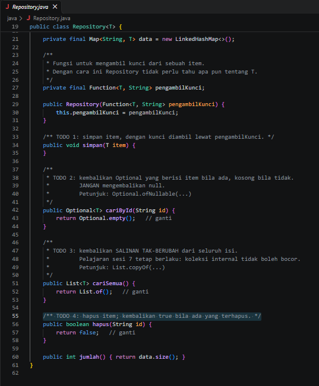

- After:

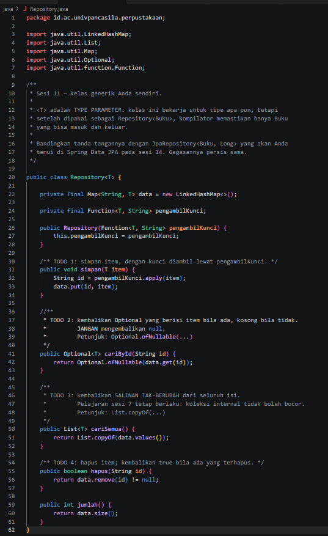

TODO 1: menyimpan data ke dalam LinkedHashMap dengan menggunakan ID sebagai kunci agar setiap data bisa dibedakan.

TODO 2: mencari data berdasarkan ID. Jika data ditemukan, program akan mengembalikan data tersebut, sedangkan jika tidak ditemukan akan menghasilkan Optional.empty().

TODO 3: mengambil seluruh data yang tersimpan dan mengembalikannya dalam bentuk List yang tidak bisa diubah.

TODO 4: menghapus data berdasarkan ID. Jika data berhasil dihapus, hasilnya true, sedangkan jika tidak ditemukan hasilnya false.

b. RepositoryTest.java

Screenshot:

- Before :

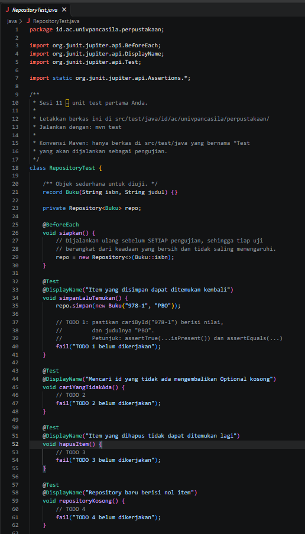
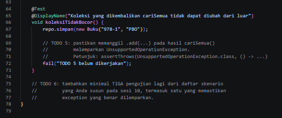

- After:

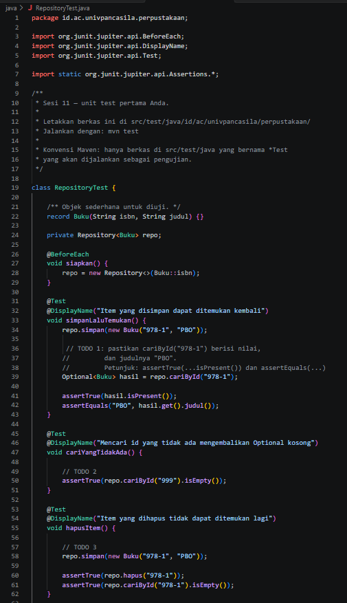
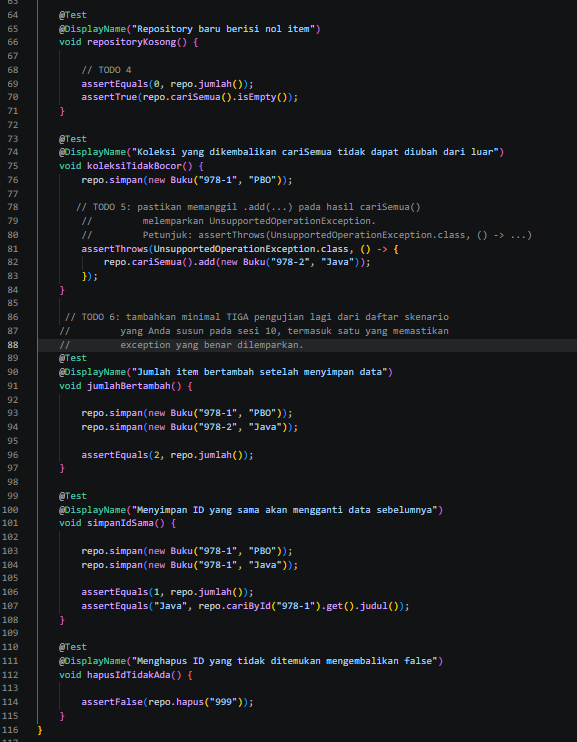

TODO 1: data berhasil disimpan dan ditemukan berdasarkan ID yang sesuai.

TODO 2: Menguji pencarian data menggunakan ID yang tidak tersedia untuk memastikan hasilnya kosong.

TODO 3: data yang sudah disimpan berhasil dihapus dari repository.

TODO 4: repository yang belum memiliki data menghasilkan jumlah data nol.

TODO 5: daftar data yang dihasilkan tidak bisa diubah dengan menambahkan data baru.

TODO 6: Menambahkan pengujian untuk memastikan jumlah data bertambah setelah penyimpanan, data dengan ID yang sama menggantikan data sebelumnya, dan penghapusan ID yang tidak tersedia menghasilkan false.

# PHP

a. KoleksiBuku.php

Screenshot:

- Before :

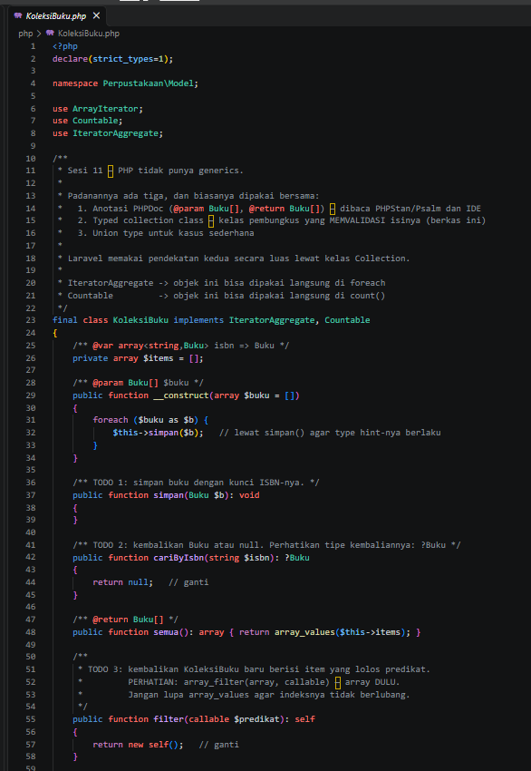
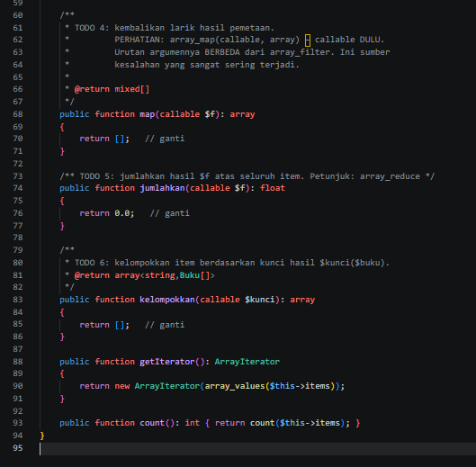

- After:

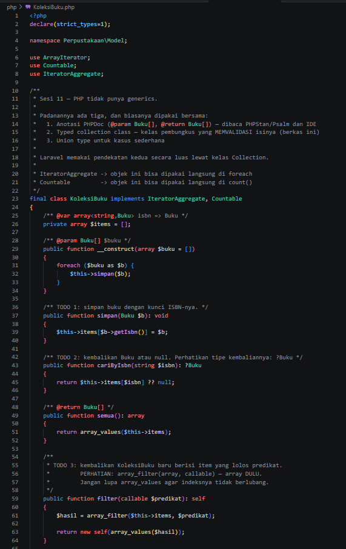
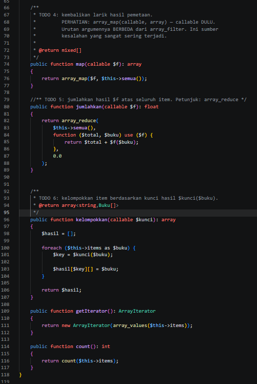

TODO 1: menyimpan data buku ke dalam koleksi dengan menggunakan ISBN sebagai kunci.

TODO 2: mencari buku berdasarkan ISBN. Jika buku ditemukan, program mengembalikan objek buku, sedangkan jika tidak ditemukan akan menghasilkan null.

TODO 3: menyaring buku berdasarkan kondisi tertentu menggunakan array_filter(), contohnya memilih buku yang stoknya masih tersedia.

TODO 4: mengubah data buku menjadi bentuk lain menggunakan array_map(), contohnya mengambil seluruh judul buku.

TODO 5: menjumlahkan data dari seluruh buku menggunakan array_reduce(), contohnya menghitung total stok buku.

TODO 6: mengelompokkan buku berdasarkan kriteria tertentu, contohnya berdasarkan nama penulis.

b. KoleksiBukuTest.php

Screenshot:

- Before :

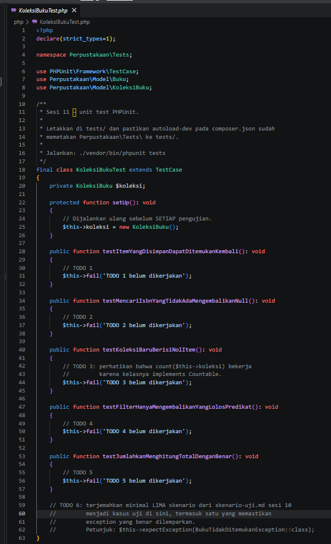

- After:

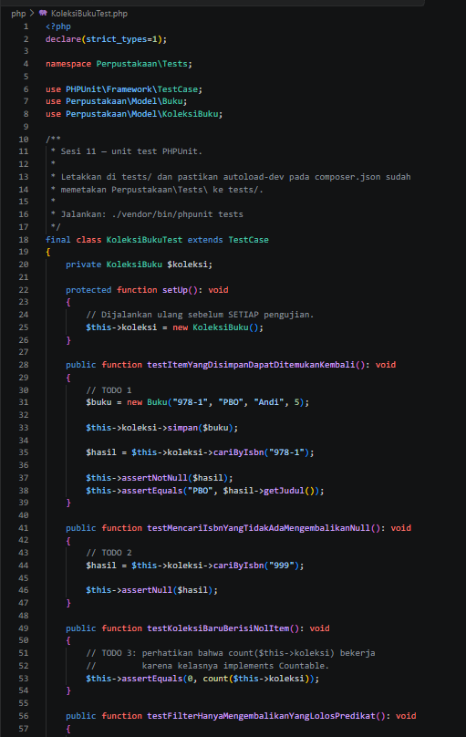
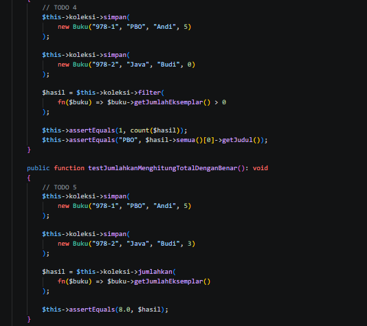
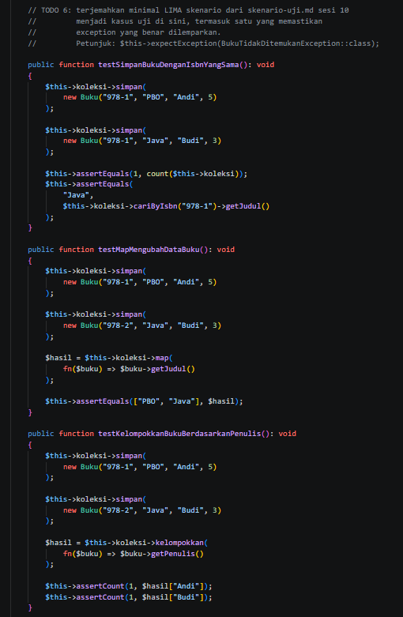
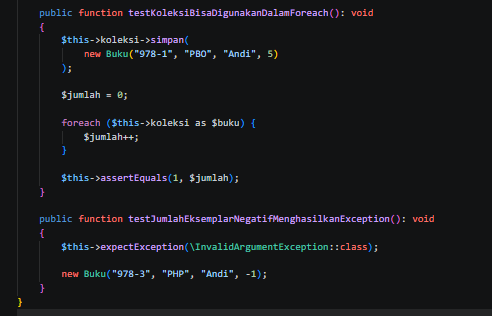

TODO 1: buku berhasil disimpan dan ditemukan berdasarkan ISBN.

TODO 2: Menguji pencarian buku menggunakan ISBN yang tidak tersedia untuk memastikan hasilnya null.

TODO 3: jumlah koleksi buku yang masih kosong menghasilkan nilai nol.

TODO 4: Menguji fungsi filter untuk memastikan hanya buku yang memenuhi kondisi yang dipilih.

TODO 5: Menguji fungsi penjumlahan untuk memastikan total stok seluruh buku sesuai dengan hasil yang diharapkan.

TODO 6: Menambahkan pengujian untuk memastikan ISBN yang sama menggantikan data sebelumnya, fungsi map berhasil mengambil judul buku, fungsi group berhasil mengelompokkan buku berdasarkan penulis, data bisa dibaca menggunakan foreach, dan validasi stok negatif menghasilkan pengecualian yang diharapkan.

---

Kesimpulan : Pada Pertemuan 11, praktikum membahas penggunaan Generic pada Java dan Typed Collection pada PHP, serta penerapan unit testing. Pada Java, materi diterapkan melalui pembuatan class Repository yang dapat digunakan untuk berbagai tipe data dan pengujian menggunakan JUnit 5. Sementara itu, pada PHP, materi diterapkan melalui class KoleksiBuku untuk mengelola kumpulan data buku menggunakan array dan berbagai fungsi pengolahan data. Pengujian dilakukan menggunakan PHPUnit untuk memastikan setiap method berjalan sesuai dengan fungsinya. Dengan praktikum ini, dapat dipahami cara mengelola kumpulan objek, menggunakan tipe data yang sesuai, dan melakukan pengujian agar program lebih terstruktur dan mudah diperiksa.
