# LAPORAN PRAKTIKUM PBO - A

NAMA        : Theofani Natanya Anari Hutabarat

NPM         : 4525210074

MATA KULIAH : Pemrograman Berbasis Objek

KELAS       : A

MATERI      : Pertemuan 12

DOSEN       : Adi Wahyu Pribadi, S.Si., M.Kom.

# JAVA

a. AturanDenda.java

Screenshot:

- Before :

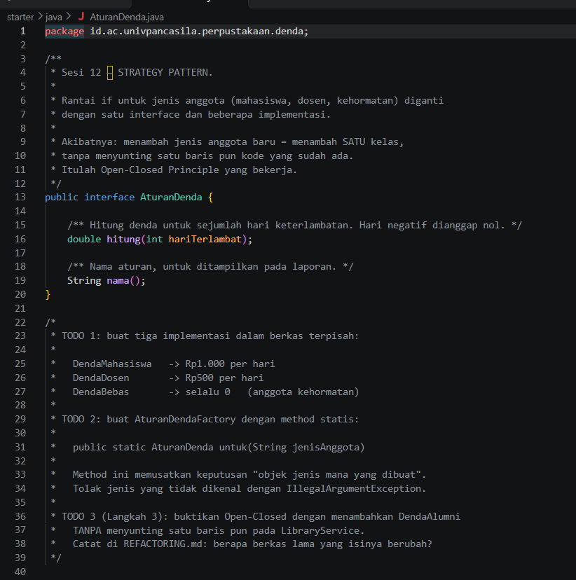

- After:

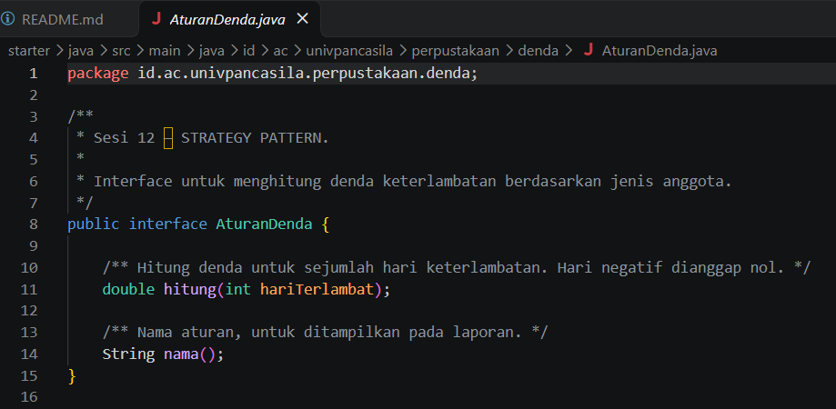
Interface AturanDenda digunakan sebagai aturan dasar untuk menghitung denda keterlambatan pengembalian buku berdasarkan jenis anggota. Interface ini memiliki dua method, yaitu hitung() untuk menghitung jumlah denda berdasarkan hari keterlambatan dan nama() untuk menampilkan nama aturan denda yang digunakan.

b. AturanDendaFactory.java

Screenshot:

- After:

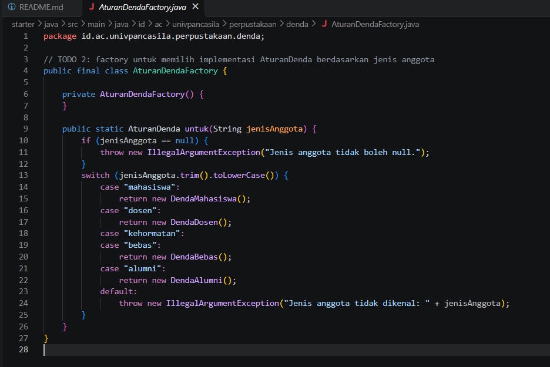

Class AturanDendaFactory digunakan untuk memilih aturan denda berdasarkan jenis anggota perpustakaan. Class ini menerapkan Factory Pattern dengan mengembalikan objek denda yang sesuai, seperti mahasiswa, dosen, kehormatan, bebas, dan alumni. Jika jenis anggota tidak dikenali atau bernilai null, sistem akan menampilkan pesan kesalahan.

c. DendaAlumni.java

Screenshot:

- After:

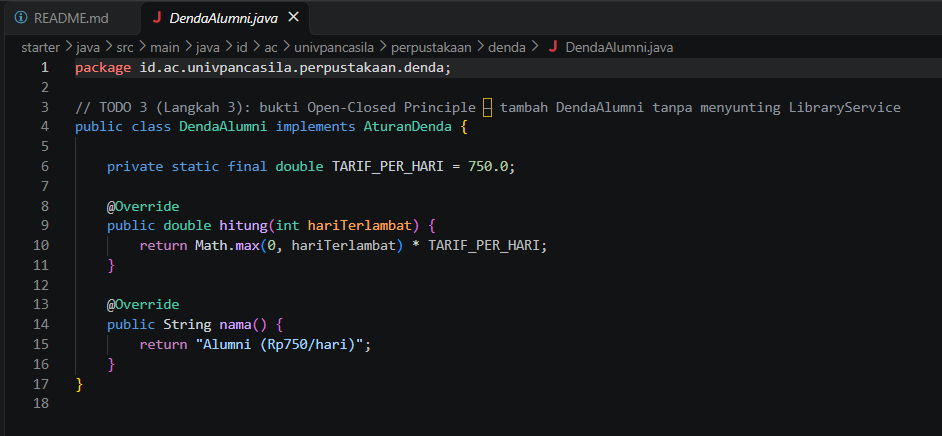

Class DendaAlumni merupakan implementasi interface AturanDenda yang digunakan untuk menghitung denda keterlambatan bagi anggota alumni. Besaran denda ditetapkan sebesar Rp750 per hari. Class ini juga menerapkan prinsip Open-Closed Principle (OCP), sehingga aturan denda baru dapat ditambahkan tanpa perlu mengubah kode pada LibraryService.

d. DendaBebas.java

Screenshot:

- After:

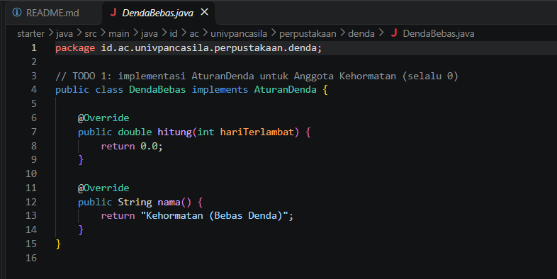

Class DendaBebas merupakan implementasi interface AturanDenda yang digunakan untuk anggota kehormatan. Class ini menetapkan bahwa anggota kehormatan tidak dikenakan biaya denda keterlambatan, sehingga berapa pun jumlah hari keterlambatan, denda yang harus dibayar tetap Rp0.00.

e. DendaDosen.java

- After:

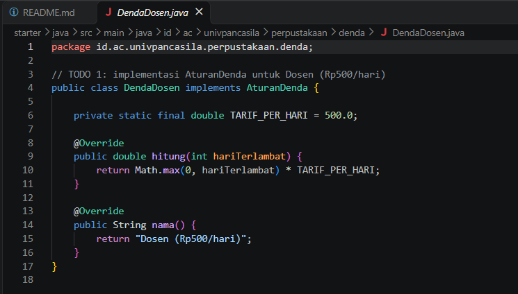

Class DendaDosen merupakan implementasi interface AturanDenda yang digunakan untuk menghitung denda keterlambatan bagi anggota dosen. Besaran denda ditetapkan sebesar Rp500 per hari keterlambatan. Jika jumlah hari keterlambatan bernilai negatif, sistem akan menganggapnya sebagai nol.

f. DendaMahasiswa.java

Screenshot:

- After:

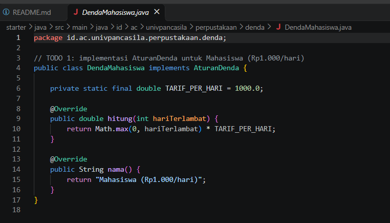

Class DendaMahasiswa merupakan implementasi interface AturanDenda yang digunakan untuk menghitung denda keterlambatan bagi anggota mahasiswa. Besaran denda ditetapkan sebesar Rp1.000 per hari keterlambatan. Jika jumlah hari keterlambatan bernilai negatif, sistem akan menganggapnya sebagai nol.

g. BookRepository.java

Screenshot:

- Before :

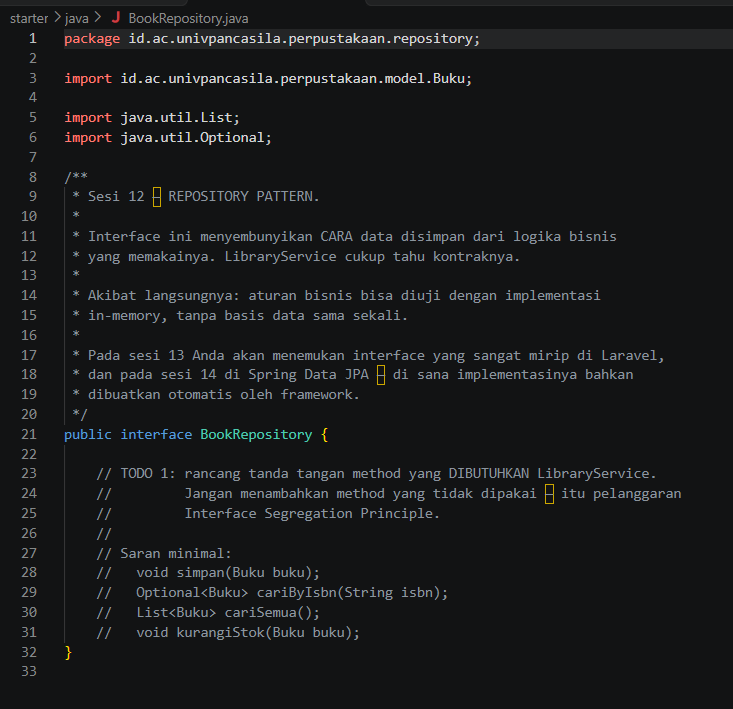

- After:

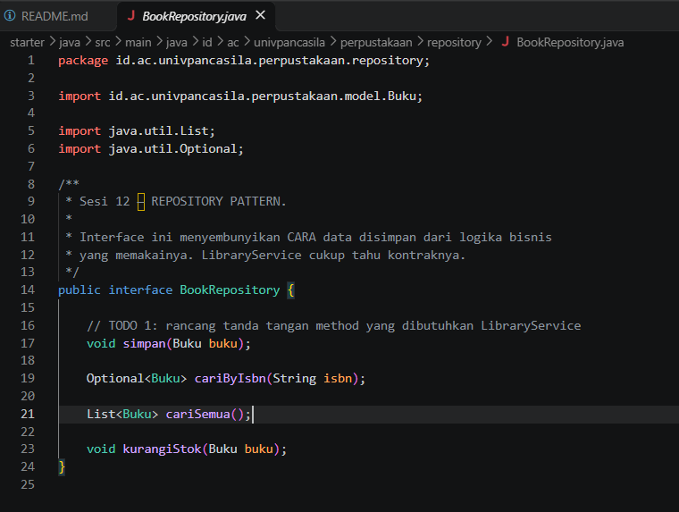

Interface BookRepository digunakan untuk menerapkan Repository Pattern, yaitu memisahkan pengelolaan penyimpanan data buku dari logika bisnis program. Interface ini menyediakan beberapa method, yaitu simpan() untuk menyimpan buku, cariByIsbn() untuk mencari buku berdasarkan ISBN, cariSemua() untuk menampilkan seluruh buku, dan kurangiStok() untuk mengurangi jumlah stok buku. Dengan adanya interface ini, pengelolaan data menjadi lebih terstruktur dan mudah dikembangkan.

h. InMemoryBookRepository.java

Screenshot:

- Before :

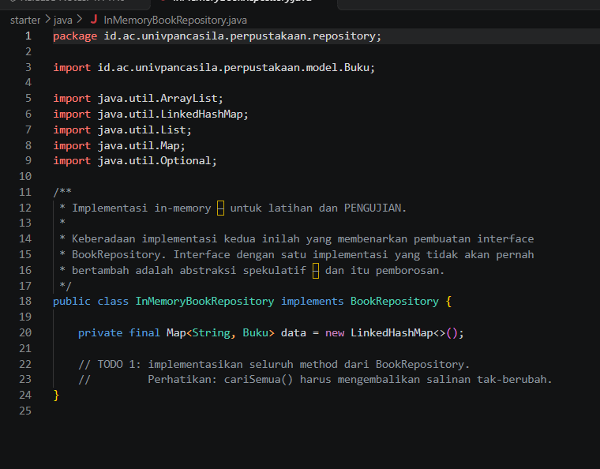

- After:

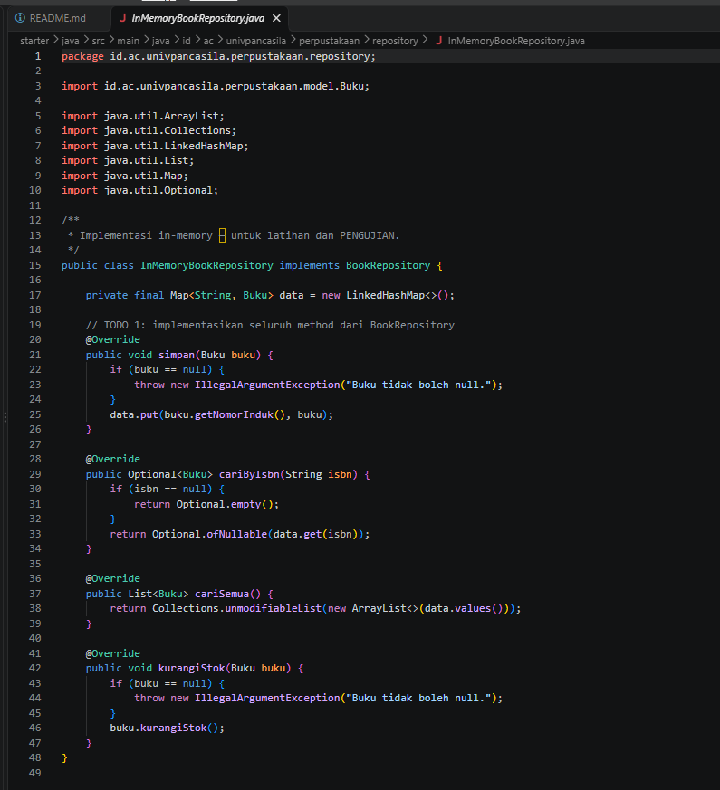

Class InMemoryBookRepository merupakan implementasi dari interface BookRepository yang digunakan untuk mengelola data buku sementara di dalam memori. Class ini memiliki method untuk menyimpan buku, mencari buku berdasarkan ISBN, menampilkan seluruh data buku, dan mengurangi stok buku. Data disimpan menggunakan LinkedHashMap sehingga urutan penyimpanan tetap terjaga.

i. Repository.java

- After:

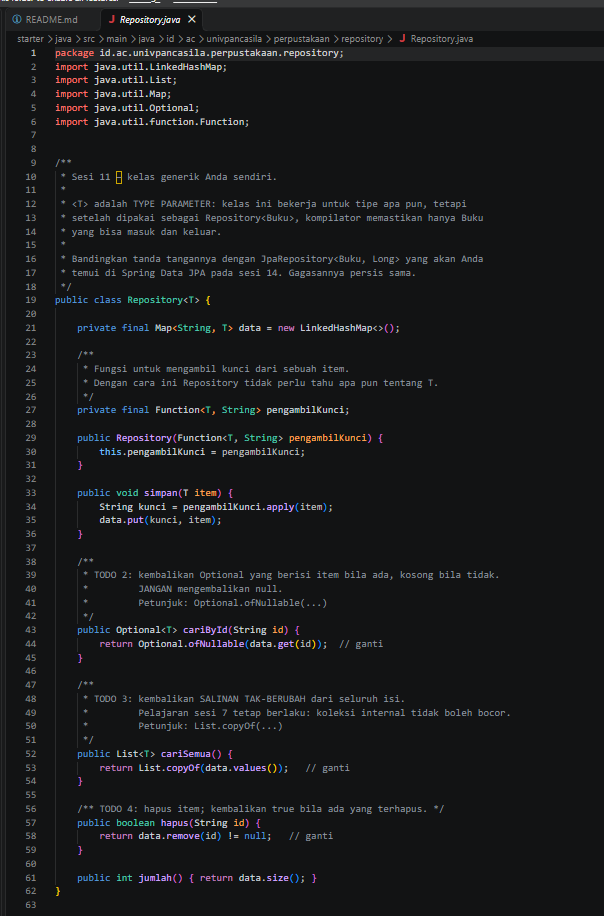

Class Repository<T> merupakan class generik yang digunakan untuk mengelola penyimpanan data dengan berbagai jenis objek. Class ini menyediakan method simpan() untuk menyimpan data, cariById() untuk mencari data berdasarkan ID, cariSemua() untuk menampilkan seluruh data, hapus() untuk menghapus data, dan jumlah() untuk menghitung jumlah data. Class ini juga menggunakan Optional agar pencarian data tidak mengembalikan nilai null serta List.copyOf() untuk menjaga agar data internal tidak dapat diubah secara langsung.

# PHP

a. AturanDenda.php

Screenshot:

- After:

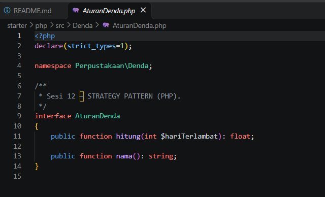

Interface AturanDenda digunakan sebagai aturan dasar untuk menghitung denda keterlambatan pengembalian buku berdasarkan jenis anggota. Interface ini memiliki dua method, yaitu hitung() untuk menghitung jumlah denda berdasarkan hari keterlambatan dan nama() untuk menampilkan nama aturan denda yang digunakan. Dengan adanya interface ini, setiap jenis anggota dapat memiliki aturan perhitungan denda yang berbeda.

b. AturanDendaFactory.php

Screenshot:

- After:

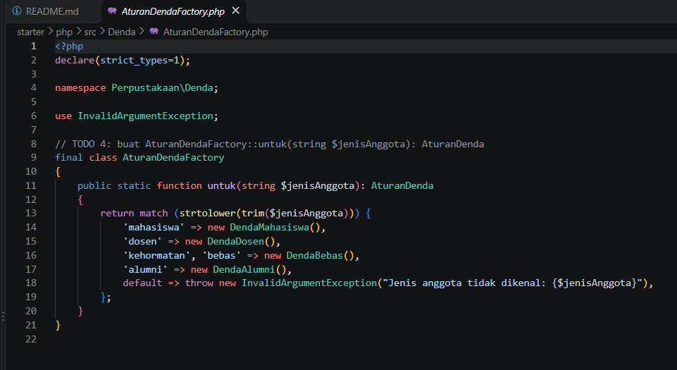

Class AturanDendaFactory digunakan untuk memilih aturan denda berdasarkan jenis anggota perpustakaan. Class ini menerapkan Factory Pattern dengan menggunakan match untuk menentukan objek denda yang sesuai, yaitu mahasiswa, dosen, kehormatan, bebas, atau alumni. Jika jenis anggota tidak dikenali, sistem akan menampilkan pesan kesalahan menggunakan InvalidArgumentException.

c. DendaAlumni.php

Screenshot:

- After:

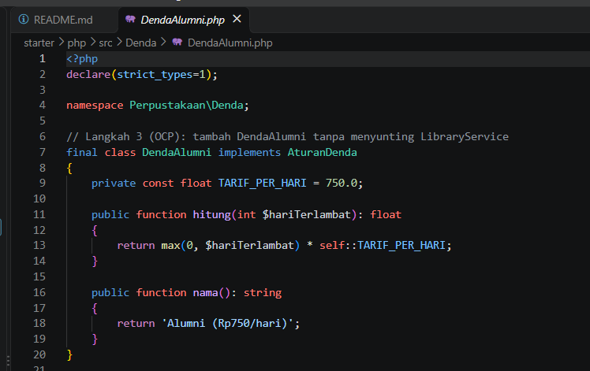

Class DendaAlumni merupakan implementasi interface AturanDenda yang digunakan untuk menghitung denda keterlambatan bagi anggota alumni. Besaran denda ditetapkan sebesar Rp750 per hari. Class ini menerapkan prinsip Open-Closed Principle (OCP), sehingga aturan denda baru dapat ditambahkan tanpa perlu mengubah kode pada LibraryService.

d. DendaBebas.php

Screenshot:

- After:

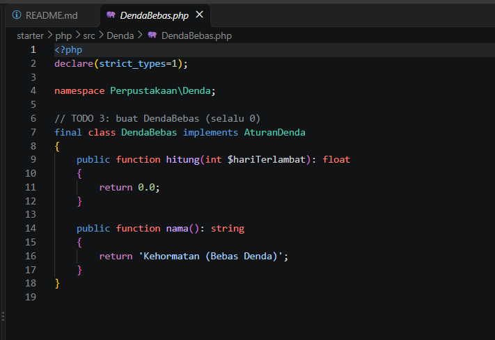

Class DendaBebas merupakan implementasi interface AturanDenda yang digunakan untuk anggota kehormatan. Class ini menetapkan bahwa anggota kehormatan tidak dikenakan denda keterlambatan, sehingga berapa pun jumlah hari keterlambatan, denda yang harus dibayar tetap Rp0,00.

e. DendaDosen.php

Screenshot:

- After:

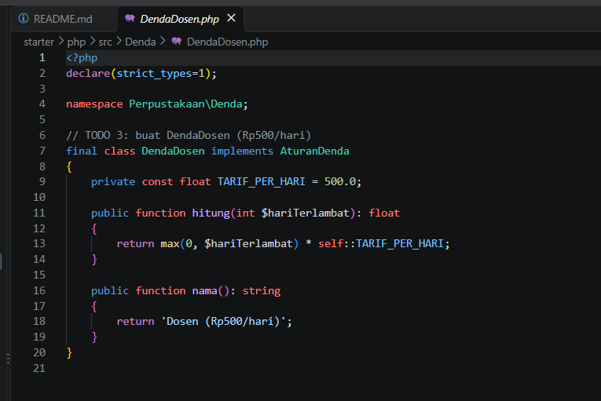

Class DendaDosen merupakan implementasi interface AturanDenda yang digunakan untuk menghitung denda keterlambatan bagi anggota dosen. Besaran denda ditetapkan sebesar Rp500 per hari keterlambatan. Jika jumlah hari keterlambatan bernilai negatif, sistem akan menganggapnya sebagai nol.

f. DendaMahasiswa.php

Screenshot:

- After:

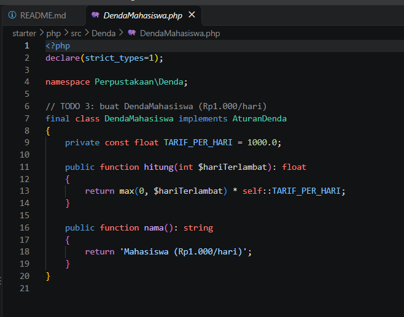

Class DendaMahasiswa merupakan implementasi interface AturanDenda yang digunakan untuk menghitung denda keterlambatan bagi anggota mahasiswa. Besaran denda ditetapkan sebesar Rp1.000 per hari keterlambatan. Jika jumlah hari keterlambatan bernilai negatif, sistem akan menganggapnya sebagai nol.

g. BookRepository.php

Screenshot:

- After:

Interface BookRepository digunakan untuk menerapkan Repository Pattern, yaitu memisahkan pengelolaan penyimpanan data buku dari logika bisnis program. Interface ini menyediakan beberapa method, yaitu simpan() untuk menyimpan buku, cariByIsbn() untuk mencari buku berdasarkan ISBN, cariSemua() untuk menampilkan seluruh data buku, dan kurangiStok() untuk mengurangi stok buku. Dengan adanya interface ini, pengelolaan data menjadi lebih terstruktur dan mudah dikembangkan.

h. InMemoryBookRepository.php

Screenshot:

- After:

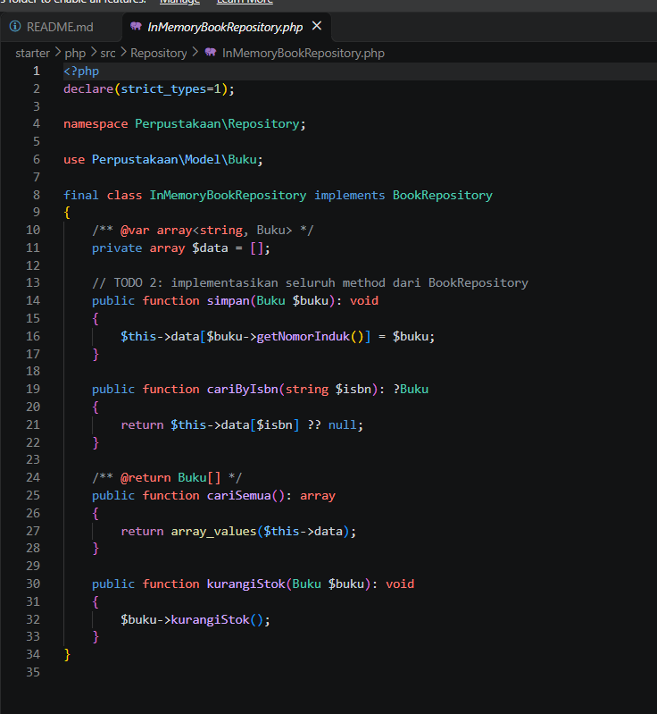

Class InMemoryBookRepository merupakan implementasi dari interface BookRepository yang digunakan untuk mengelola data buku sementara di dalam memori. Class ini memiliki method untuk menyimpan buku, mencari buku berdasarkan ISBN, menampilkan seluruh data buku, dan mengurangi stok buku. Data disimpan menggunakan array sehingga pengelolaan data menjadi lebih sederhana dan mudah digunakan untuk latihan maupun pengujian.

i. Repository.php

Screenshot:

- Before :

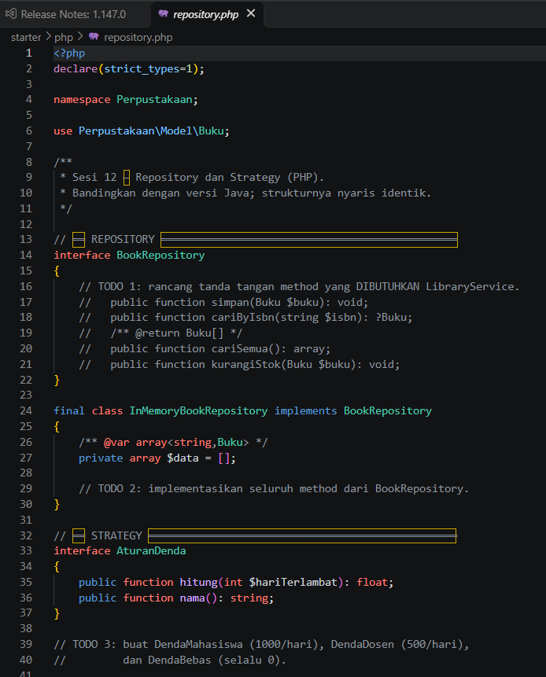
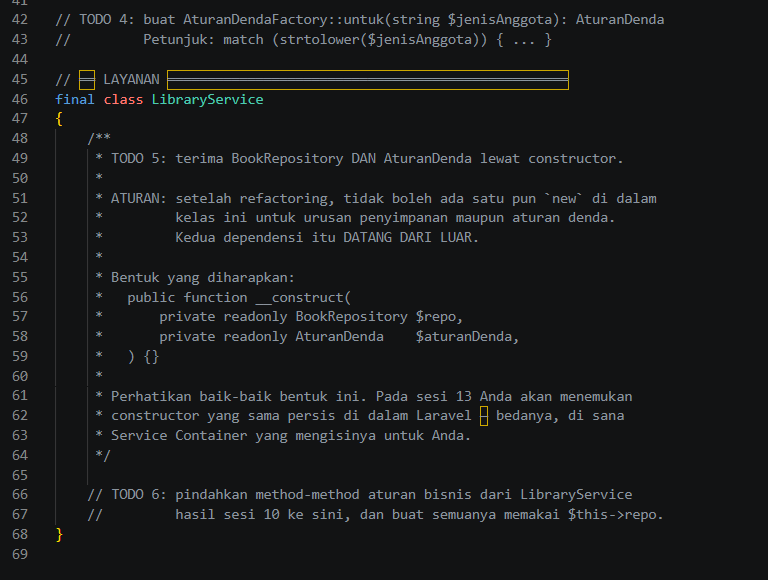

- After:

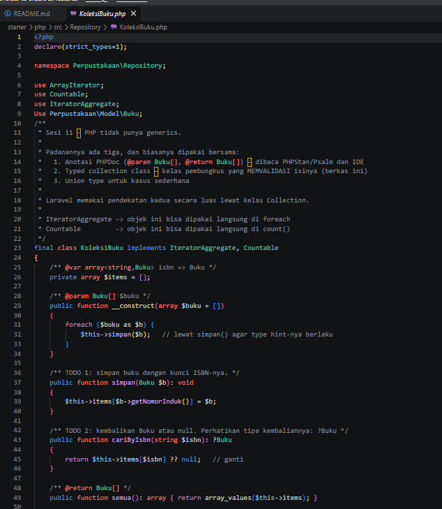
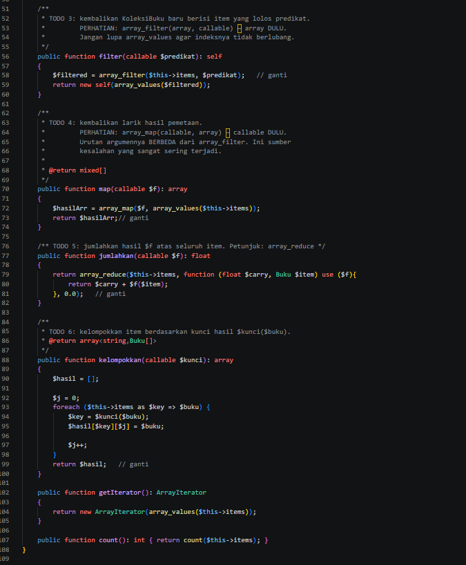

Class KoleksiBuku digunakan untuk mengelola kumpulan data buku dengan menerapkan konsep Typed Collection pada PHP. Class ini menyediakan method untuk menyimpan buku, mencari buku berdasarkan ISBN, menampilkan seluruh data, memfilter dan memetakan data, menjumlahkan nilai, serta mengelompokkan buku berdasarkan kriteria tertentu. Class ini juga menggunakan IteratorAggregate dan Countable, sehingga data dapat diakses menggunakan foreach dan dihitung menggunakan count().

---
Pada praktikum Sesi 12, dilakukan penerapan beberapa konsep pemrograman berorientasi objek menggunakan Java dan PHP, yaitu Strategy Pattern, Factory Pattern, Repository Pattern, dan Open-Closed Principle (OCP). Strategy Pattern digunakan untuk membuat aturan denda yang berbeda berdasarkan jenis anggota perpustakaan. Factory Pattern membantu memilih aturan denda secara otomatis, sedangkan Repository Pattern digunakan untuk memisahkan pengelolaan data buku dari logika bisnis. Selain itu, konsep OCP memungkinkan penambahan aturan baru tanpa harus mengubah kode yang sudah ada.
